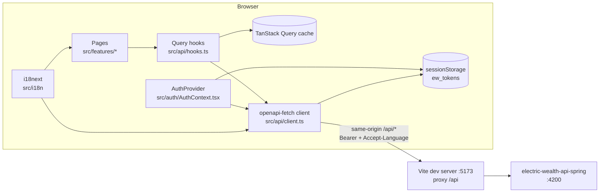

## 4. Architecture and Design Patterns

### 4.1 High-Level Architecture

Layers, top to bottom:

| Layer | Responsibility | Files |
|---|---|---|
| Shell | Providers, route tables, signed-in layout | `main.tsx`, `App.tsx`, `components/Layout.tsx` |
| Pages | Read route params and local UI state, call hooks, render loading / error / empty / data | `features/**` |
| Shared UI | Stateless presentational components, SVG charts | `components/ui.tsx`, `components/charts.tsx` |
| Data hooks | One `useQuery` / `useMutation` per API operation; cache keys; cache updates after mutations | `api/hooks.ts` |
| API client | Typed fetch, auth + language headers, 401 broadcast, error unwrapping | `api/client.ts` (+ generated `schema.d.ts`) |
| Session | Auth phase, token storage, idle timeout, token refresh | `auth/*` |
| Helpers | Locale-aware formatting, deep-link mapping | `lib/*`, `i18n/*` |

### 4.2 Data Flow

**Read path** — example: opening `/accounts/a1`:

1. `BrowserRouter` matches `accounts/:id` inside the signed-in table → `AccountDetailPage` ([App.tsx](../../src/App.tsx)).
2. The page reads `id` with `useParams()` and calls `useAccount(id)` ([AccountDetailPage.tsx](../../src/features/accounts/AccountDetailPage.tsx)).
3. `useAccount` runs `useQuery({ queryKey: ['account', id], queryFn: … api.GET('/api/wealth/accounts/{id}') })`
   ([hooks.ts](../../src/api/hooks.ts)).
4. The `headersMiddleware` adds `Authorization: Bearer <accessToken>` and `Accept-Language: <locale>`
   ([client.ts](../../src/api/client.ts)); the request goes to `window.location.origin/api/...`, which Vite proxies to
   the API.
5. `unwrap()` returns `data` or throws `ApiError(status, code, message, traceId)` from the API's `ErrorEnvelope`.
6. The page renders `<Loading/>`, a 404 `EmptyState`, `<ErrorState/>` with retry, or the data. Child sections
   (`PerformanceSection`, `TransactionsSection`) run their own queries in parallel.

**Write path** — example: renaming an account:

1. `NicknameEditor` calls `useUpdateAccount(id).mutate({ nickname })`.
2. The mutation `PATCH`es `/api/wealth/accounts/{id}`.
3. `onSuccess` writes the returned account into `['account', id]` and invalidates `['accounts']` and `['dashboard']`,
   so the list and dashboard refetch next time they are shown.

**Session-loss path:** any `401` from a non-`/api/auth/` URL makes the middleware dispatch `ew:unauthorized`;
`AuthProvider` listens and calls `logout('expired')` (only if MFA was verified), which clears tokens and the whole
query cache, and `App` swaps to the signed-out route table. See [09](09-authentication-and-authorization.md).

### 4.3 Key Design Patterns

| Pattern | How it appears | Where |
|---|---|---|
| Generated, typed API client | `createClient<paths>()` with paths/schemas from OpenAPI; compile errors when the contract changes | `client.ts`, `schema.d.ts` |
| Query-hook-per-endpoint | Pages never call `api` directly — except the registration wizard and document download, which use `api` inline | `hooks.ts`; exceptions in `RegisterPage.tsx`, `DocumentsPage.tsx` |
| Centralised query keys | `queryKeys` object; locale included where the API localises | `hooks.ts` |
| Cache update over refetch | `setQueryData` with the mutation response (profile, preferences, account, notifications, messages, watchlist) | `hooks.ts` |
| Optimistic update with rollback | `useUpdatePreferences`: `onMutate` snapshot → merge → `onError` restore | `hooks.ts` |
| Phase-switched routing | Two `<Routes>` tables chosen by `useAuth().phase` instead of per-route guards | `App.tsx` |
| Middleware + window event for cross-cutting auth | `onResponse` dispatches `ew:unauthorized`; provider subscribes | `client.ts`, `AuthContext.tsx` |
| Page state pattern | `isLoading → <Loading/>`, `error → <ErrorState onRetry>`, empty → `<EmptyState/>`, then data | every page |
| Page-local sub-components | Sections with their own query/mutation live in the page file | `AccountDetailPage.tsx`, `AdvisorPage.tsx`, `DocumentsPage.tsx` |
| Wizard with local step state | `useState(step)` + conditional render per step; API keeps the draft (`registrationId`) | `RegisterPage.tsx`, `AccountOpenPage.tsx` |
| Deep-link adapter | Server-provided mobile links mapped to routes; unsupported ones rendered disabled | `lib/deepLinks.ts` |

