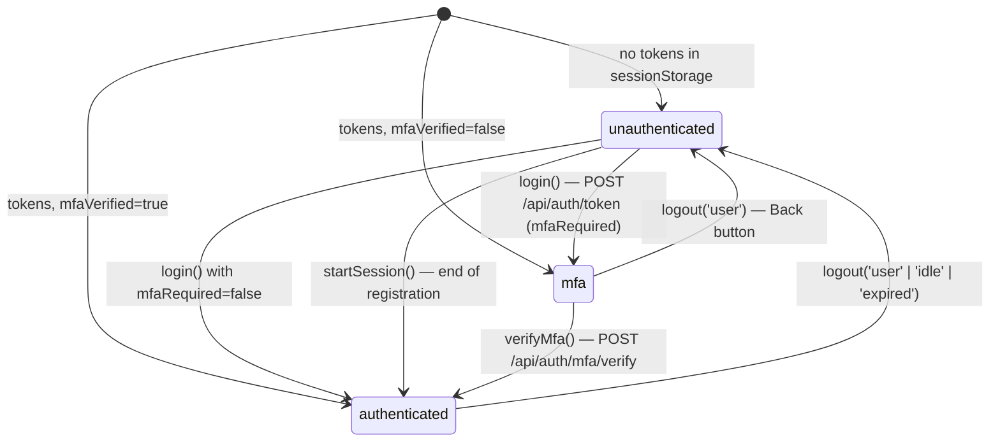

## 9. Authentication and Authorization

### 9.1 Authentication Flow

Implemented in [AuthContext.tsx](../../src/auth/AuthContext.tsx) and [tokenStore.ts](../../src/auth/tokenStore.ts),
"mirroring the mobile app's phases: unauthenticated → mfa → authenticated".

| Step | Call | Token handling |
|---|---|---|
| Password | `POST /api/auth/token` `{ grantType: 'password', username, password }` | Store `{ accessToken, refreshToken, mfaVerified: false }` |
| MFA | `POST /api/auth/mfa/verify` `{ challengeId: 'web', code, method: 'sms' }` (bearer = pre-MFA access token) | Replace `accessToken`, set `mfaVerified: true` |
| Registration finish | `POST /api/registration/complete` returns tokens | `startSession(tokens)` stores them with `mfaVerified: true` (no MFA step) |
| Refresh | Every **10 min** while authenticated: `POST /api/auth/refresh` `{ refreshToken }` | Replace both tokens (the API rotates refresh tokens); on failure `logout('expired')` |
| Idle | 15 min without `mousedown`, `keydown`, `scroll` or `touchstart` | `logout('idle')` |
| Logout | `POST /api/auth/logout` `{ refreshToken }` with explicit `Authorization` (fire-and-forget) | `tokenStore.set(null)`, `queryClient.clear()`, set `signOutReason`, phase → `unauthenticated` |
| 401 anywhere (not `/api/auth/*`) | `ew:unauthorized` event | `logout('expired')` if `mfaVerified` |

The access-token lifetime is 900 s on the API (`SessionRepository`); the 10-minute refresh keeps a 5-minute margin.
Timers run only while `phase === 'authenticated'` and are reset by the effect cleanup.

**Token storage:** `sessionStorage['ew_tokens']` as JSON, mirrored in a module variable. "A page refresh keeps you
signed in, but closing the tab signs you out." Each tab has its own session. If storage is unavailable, tokens live in
memory only.

**Sign-out reasons** shown on the login page: `idle` → `web.idle_signed_out` ("You were signed out after 15 minutes
of inactivity."), `expired` → `auth.session_expired`; `user` shows nothing.

### 9.2 Authorization

The web app has **no roles or permissions**. Every signed-in user sees the same pages; the data is scoped by the API to
the token's user. Client-side "authorization" is only the phase switch in [App.tsx](../../src/App.tsx) (see
[05.2](05-routing-and-navigation.md#52-navigation-guards-and-protection)).

Server-enforced boundaries visible to the UI:

| Boundary | UI effect |
|---|---|
| Protected operations need a verified (post-MFA) access token | A pre-MFA token gets `401`; the MFA page treats an `UNAUTHORIZED` error code as an expired session |
| Resources belong to the signed-in user | Another user's account id returns `404` → not-found state |
| Registration requires a matching client record | `IDENTITY_MISMATCH`, `ALREADY_ENROLLED` messages |

Features that exist only in the mobile app are not hidden by permission but by the deep-link map (tag
"Mobile app only").

